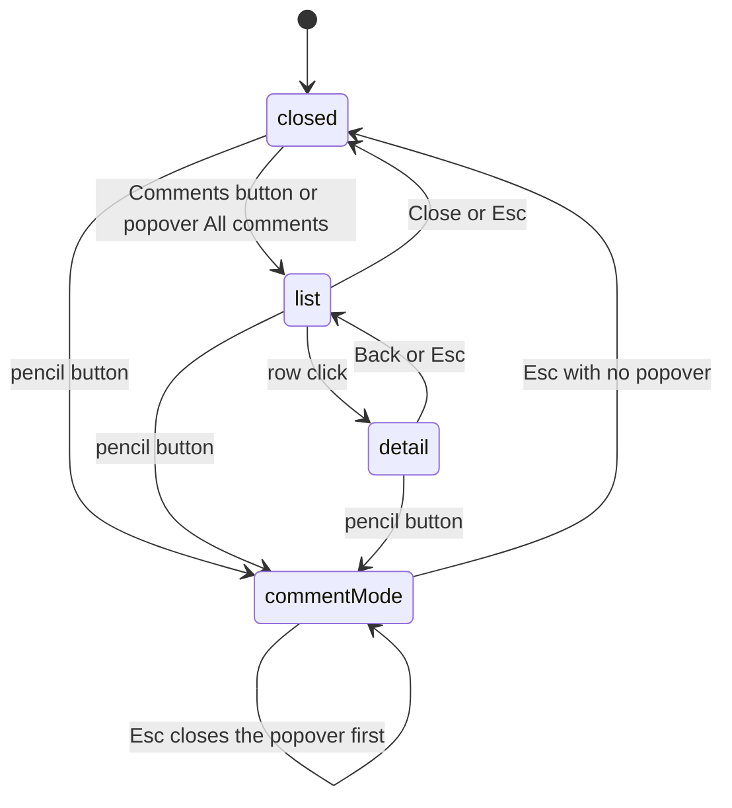
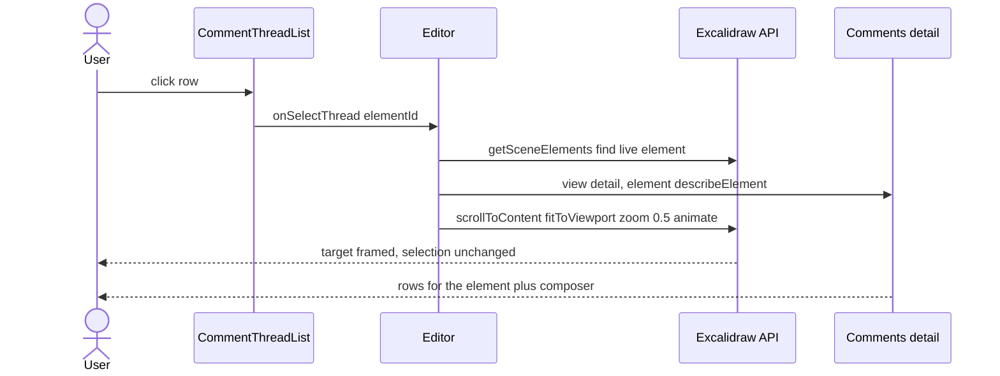

# Comments browser

The comments aside has two levels. The scene-wide list is the default. A row opens the existing per-element thread. Back returns to the list with the filter intact. Nothing draws on the canvas, and no server operation was added.

## Panel states

The panel and comment mode are mutually exclusive. Esc in detail goes back first. Esc in the list closes the panel. The comment-mode Esc listener belongs to Editor and unmounts with the panel.

## Row click

Selection is deliberately untouched. Excalidraw reports a selection change through `onChange`, which clears the panel target and would tear down the detail that just opened.

## Data

`buildThreads` groups flat `comment-list` records by element id. The newest record by createdAt, with id as tiebreak, carries the row. Threads sort open before resolved, then newest first, then element id. `filterThreads` applies status then a case-insensitive query over body and name. `threadCounts` feeds the toolbar.

Rows come only from `comment-list`. The server already skips comments on deleted elements. There are no replies, so a thread is just a group of comments on one element.

## Entry points

| Action | Result |
| --- | --- |
| Header Comments button | Opens the list and marks the button active |
| Popover All comments | Opens the list, leaving comment mode |
| Header pencil button | Toggles comment mode and closes panel and popover |
| Aside pencil button | Leaves the panel for comment mode |
| Row click | Frames the element and opens its thread |
