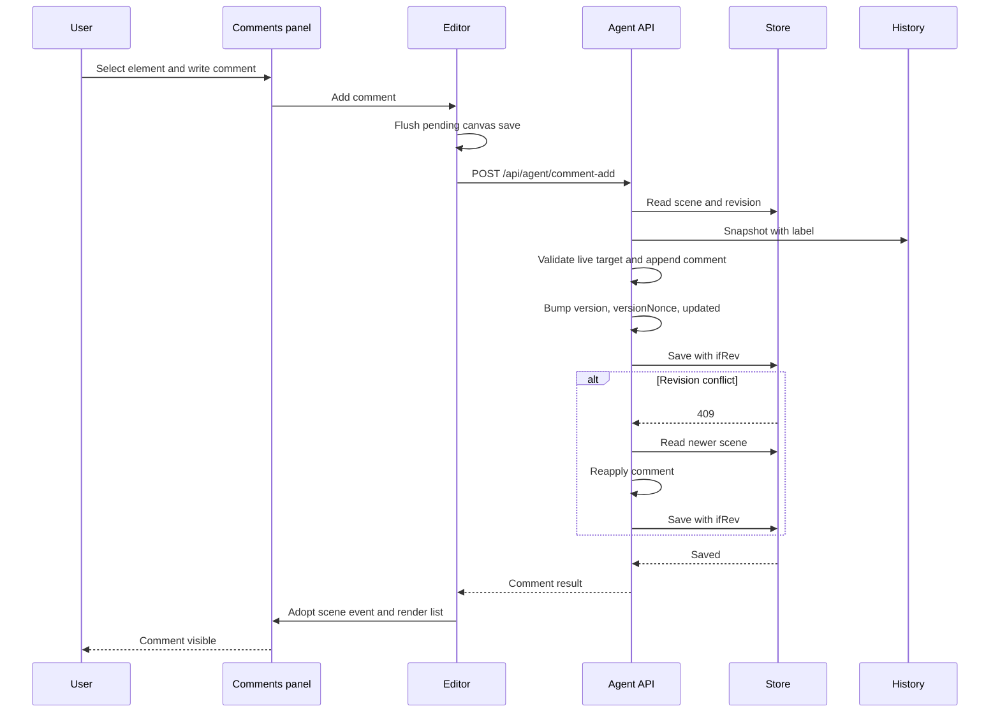
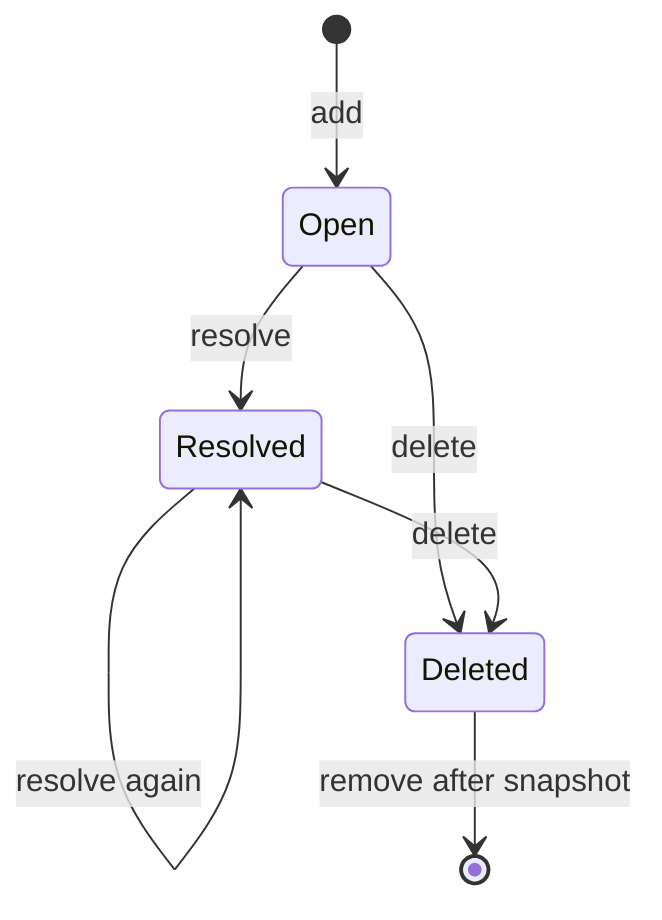

# Element-attached comments: decision

## Verdict

GO. Store comments on the element, expose them through a small Excalidraw sidebar, and route every comment mutation through the existing agent API. This gives comments the same save, copy, duplicate, snapshot, and revision behavior as the drawing without adding a second source of truth.

The checkout has no `node_modules`. `package-lock.json:634-637` pins Excalidraw 0.18.1. I inspected that tarball and ran a Chromium probe. It confirmed `customData` survives `updateScene`, undo, redo, JSON save and load, duplicate, paste, and `Sidebar`. A scratch-vault probe confirmed Sketchdex saves, renames, duplicates, and snapshots it unchanged.

## What Excalidraw preserves

`customData` is a public element field typed as `Record<string, any>` in `@excalidraw/excalidraw/dist/types/excalidraw/element/types.d.ts:27-72`. Iframe elements narrow it to `generationData` at lines 98-103, so Sketchdex should use a namespaced object and treat the base field as extensible.

| Operation | Result | Evidence |
|---|---|---|
| `updateScene` | Preserves supplied fields. The caller must bump `version` and `versionNonce` for the change to enter history. | `components/App.tsx:3885-3944` replaces elements without rebuilding them. `store.ts:377-404` detects changes by `versionNonce`. |
| Undo and redo | Preserves `customData` when the element version changes. | `change.ts:946-973` records changed fields. `change.ts:1208-1264` applies them through `newElementWith`, which spreads the old element at `element/mutateElement.ts:149-180`. |
| Save and load | Preserves live elements and unknown element fields. | `data/restore.ts:145-223` explicitly retains `customData` and spreads original properties for forward compatibility. `data/json.ts:43-69` serializes elements. |
| Copy and paste | Preserves it on the pasted copy. | `clipboard.ts:158-178` serializes whole elements. `clipboard.ts:388-400` parses them. `components/App.tsx:3094-3108` and `3188-3234` restore, offset, and duplicate them. |
| Duplicate | Preserves it on the clone. | `element/newElement.ts:644-673` deep-copies the element and changes identity, bindings, seed, and groups only. |
| Export | `.excalidraw` keeps it on live elements. PNG and SVG do not draw it. Embedded scene metadata includes it only when requested. | `element/index.ts:103-118` filters deleted elements and clears `lastCommittedPoint`. `appState.ts:61` defaults `exportEmbedScene` to false. `utils/export.ts:139-143` adds PNG metadata only when that option is true. |

The Excalidraw sources above live in `dist/dev/*.js.map` as `sourcesContent`. There is no generic unknown-field strip. Restore drops selection elements, invisibly small elements, and unsupported types at `data/restore.ts:490-523`. Text restore deletes only legacy `rawText` at lines 230-234. JSON export drops `isDeleted` elements and resets linear `lastCommittedPoint` at `element/index.ts:103-118`.

The probe observed undo remove the comment and redo restore it. Duplicate and paste each produced one copy with the same `customData`. Default PNG chunks were `IHDR`, `IDAT`, and `IEND`. Embedded PNG added `tEXt`.

## What Sketchdex preserves

`Editor.tsx:267-290` puts Excalidraw's element array into `latest.current` without projecting fields. `src/lib/store.ts:147-163` serializes that payload unchanged. `server/middleware.js:278-297` passes it to `store.save`. `server/store.js:140-168` reads and writes `payload.elements` wholesale.

No app path rebuilds elements. Reconciliation chooses the newer whole element at Excalidraw `data/reconcile.ts:19-39` and `73-117`. Sketchdex paints it at `Editor.tsx:355-384`. Thumbnails only render at `src/lib/thumbnail.ts:11-32`. Legacy import forwards the payload at `src/lib/migrate.ts:23-29` and `server/store.js:329-345`. Rename preserves it at `server/store.js:257-271`. History stores complete elements at `server/history.js:116-125`.

Agent patches also preserve comments. `patchElement` spreads the element at `server/elements.js:640-685`. `updateElements`, `moveElements`, and `deleteElements` use it or object spread at `server/agent.js:421-487` and `500-576`. A scratch probe confirmed comments survived a patch, a move, and soft deletion. `describeScene` currently omits them at `server/agent.js:68-99`.

One boundary matters. `server/store.js:140-148` and `151-168` whitelist top-level scene fields. A scene-level comments blob would be dropped. Element fields are not whitelisted.

## Custom UI hooks

Use the public `Sidebar`, exported at `@excalidraw/excalidraw/dist/types/excalidraw/index.d.ts:26`. Its props and compound parts are typed at `components/Sidebar/Sidebar.d.ts:26-75`. `Sidebar.Trigger` accepts `name`, `tab`, `icon`, `title`, `children`, and `onToggle` at `components/Sidebar/common.d.ts:4-13`.

`renderSidebar` is not a prop in 0.18.1. The complete prop list at `types.d.ts:405-463` has no such hook. The supported alternatives are:

- `renderTopRightUI?: (isMobile: boolean, appState: UIAppState) => JSX.Element | null` at `types.d.ts:434`. `LayerUI.tsx:341` invokes it.
- `children?: React.ReactNode` at `types.d.ts:458`, rendered inside Excalidraw at `components/App.tsx:1609-1611`.
- `ExcalidrawImperativeAPI.toggleSidebar` at `types.d.ts:603-624`.
- `ExcalidrawImperativeAPI.getAppState` and `getSceneElementsIncludingDeleted` at lines 607-612.
- `updateScene` with `SceneData` and `CaptureUpdateAction` at `types.d.ts:464-469` and `603-604`.

The probe mounted a top-right button and custom sidebar, then opened it through `toggleSidebar`. Skip `registerAction`. Its `Action.name` is a closed union at `actions/types.d.ts:17`, so a custom action needs a cast.

## Storage decision

| Option | Strengths | Costs | Decision |
|---|---|---|---|
| A. Element `customData` | Travels with the element through save, copy, paste, duplicate, JSON export, and history. Agent reads already have access. | Same-element concurrent writes can replace the whole object. Deleted elements retain comments in their tombstone. | Recommend, with server-mediated writes. |
| B. Per-scene `comments.json` | Isolates comment writes from element versions. | Needs its own revision, atomic write, snapshot, duplicate, delete, and external-edit rules. It does not travel with a copied element or `.excalidraw` file. | Reject for MVP. |
| C. Scene-level blob | One atomic scene write. | `server/store.js` drops unknown top-level fields. `slimAppState` at `src/lib/store.ts:87-117` drops unknown app state. It does not follow copied elements. | Reject. |

Choose A under `customData.sketchdex.comments`, not a bare `comments` key. UI comment writes must call the agent endpoint rather than optimistically changing the canvas and letting whole-scene autosave resolve the conflict. The endpoint rereads the latest scene and reapplies the comment on each 409 retry through `server/agent.js:168-204`.

## Data model

Store one versioned collection on each commented element. Persist only open and resolved comments. Delete removes the comment after the pre-change snapshot.

```json
{
  "customData": {
    "sketchdex": {
      "comments": {
        "schemaVersion": 1,
        "items": [
          {
            "id": "cmt_01JABC",
            "body": "Check this connector.",
            "author": { "kind": "human", "name": "You" },
            "createdAt": 1795504147611,
            "status": "open"
          },
          {
            "id": "cmt_01JDEF",
            "body": "Use the approved colour.",
            "author": { "kind": "agent", "name": "Sketchdex agent" },
            "createdAt": 1795504000000,
            "resolvedAt": 1795504100000,
            "status": "resolved"
          }
        ]
      }
    }
  }
}
```

Model persisted comments as a discriminated union. Open has no `resolvedAt`. Resolved requires it. Comment ids are opaque strings. Element ids remain the attachment key.

## Add-comment flow



## Minimum UX and lifecycle

Track selection from `onChange` or `api.getAppState().selectedElementIds`. Enable **Comment** only for one live element. The top-right button opens `Sidebar name="comments"`. Name the target by type and a short text snippet.

With no selection, show "Select one element to comment." With no comments, show "No comments yet." Keep one textarea and one **Add comment** button. Submit with the button or Ctrl or Cmd plus Enter. Show open comments first and resolved comments collapsed. Each row has **Resolve** and **Delete**. Use native buttons, visible focus, an `aria-live` status, Escape to close, and initial focus in the textarea.

Skip an in-canvas badge. It adds drawing, hit-target, export, and accessibility work without improving the core loop. A count in the panel header is enough.



Element deletion hides its comments because all comment queries filter live elements. The soft-deleted element keeps them for scene undo. Copy and duplicate copy comments with the element.

## Agent surface

Add three MCP tools, three REST ops, and matching Node methods. Mutations require `label`, reuse `mutate`, and snapshot before the first attempt. Bump the element through `patchElement`, never by mutating `customData` in place.

| MCP tool | REST op | Arguments | Result |
|---|---|---|---|
| `add_comment` | `comment-add` | `scene`, `elementId`, `body`, `label` | `{sceneId, elementId, comment}` |
| `list_comments` | `comment-list` | `scene`, `elementId?`, `status?`, `limit?` | `{sceneId, total, open, resolved, comments}` |
| `update_comment` | `comment-update` | `scene`, `elementId`, `commentId`, `action: resolve or delete`, `label` | `{sceneId, elementId, commentId, status, changed}` |

Follow the concise style in `mcp/tools.js:146-307`. Proposed first sentences are "Add a comment to one live element without changing its geometry." "List comments on live elements, open first." "Resolve or delete one comment."

List defaults to open comments and ignores comments on `isDeleted` elements. Add and update reject soft-deleted targets. Resolve and delete are idempotent and return `changed: false` when the requested state already holds. Delete returns `status: "deleted"` after removing the record.

Add `comments: {open, resolved}` to each `describe_scene` element summary at `server/agent.js:230-255`. Keep bodies in `list_comments` and full data in `read_elements` and `read_scene`. Bump `package.json` and the lockfile from 0.1.2 to 0.2.0. `mcp/tools.js:53` reads that version for clients. Add the tools to `mcp/tools.js`, handlers, `server/middleware.js:130-151`, `BRIEF.md:54-81`, and the generated tools topic at `mcp/docs.js:46-61`. `docs/drawing.md` does not exist. The `drawing` topic is `BRIEF.md` at `mcp/docs.js:25`.

## MVP scope

| Include now | Defer |
|---|---|
| Namespaced element comments | In-canvas badges and anchors |
| Sidebar with add, list, resolve, delete | Threads, replies, mentions, notifications |
| Three agent tools and REST and Node methods | Rich text, comment editing, permissions |
| Revision-safe UI writes and snapshots | Sidecar sync and cross-scene search |
| `describe_scene` counts | Comment overlays in exports |
| Preservation and PNG metadata tests | Mobile-specific interaction redesign |

## Invariants and verification

Comments must never appear as pixels in PNG, SVG, or thumbnails unless a future explicit overlay is requested. Sketchdex `render_scene` must keep `exportEmbedScene` false. Comments must never change geometry, recreate an element, or replace its id, index, or bindings. Move and patch must preserve them. No Sketchdex migration, reconcile, rename, thumbnail, or snapshot path may strip them. External `.excalidraw` edits must reload through the revision path rather than be overwritten by stale comments. Standard Excalidraw preserves unknown fields. A third-party editor that deliberately strips them can still lose data.

Ship in verifiable units. First prove the data contract with restore, serialize, copy, duplicate, undo, and store round trips. Then add the agent mutations and 409 retry tests. Then add the sidebar and keyboard checks. Finally verify default PNG has no scene metadata.

## Remaining risk

The riskiest unknown is a simultaneous UI comment and agent geometry edit on the same element. Excalidraw reconciliation chooses one whole element by version, so a stale UI whole-scene save could discard either the comment or the new geometry. The cheapest decisive experiment is a scratch scene where the UI adds a comment while an agent moves that element, followed by a reload assertion that both the comment and the new position survive. The server-mediated UI write is the proposed fix, but that race must be proven before release.

## Built (0.3.0)

Two decisions changed while implementing.

- The panel is a sibling of History in the editor's flex row, not Excalidraw's
  `Sidebar` component. The app already had one right-hand panel with its own
  typography; a second visual language would have been gratuitous, and the panel
  sits outside the Excalidraw tree so it never fights the canvas for focus.
- The guarantee needed a server rule, not only the agent write path.
  `reconcileElements` picks the newer whole element, and a canvas save is by
  definition newer than the comment written under it, so merging by version
  alone lost the comment: the first browser pass proved it. `adoptComments` on
  `PUT /api/scenes/:id` now replaces the comments key with what the file holds
  for every surviving element, so a canvas save is never authoritative for
  comments. Resolve and delete write through the agent surface, which saves
  directly and is not rewritten by that rule.

Coverage: `test_comments.nim` for the data model and the adoption rule,
`test_http.nim` for the REST round trip and a stale PUT, `test/e2e.mjs` for the
three tools over a packed MCP client, and a browser pass that made a local edit
and an agent comment in the same second, then reloaded and saw both.

## Comment mode (0.4.0)

Figma's model turned out to be right for this. The header button now arms a
mode instead of opening a panel: a capture-phase pointer handler swallows the
click so nothing on the canvas moves or selects, the element under the cursor
is found by geometry (a bound label resolves to its shape), and a card at the
cursor lists the notes and takes a new one. "All comments" pins that shape in
the full panel, which stays as the detail view. Two Escapes: one for the card,
one for the mode.
