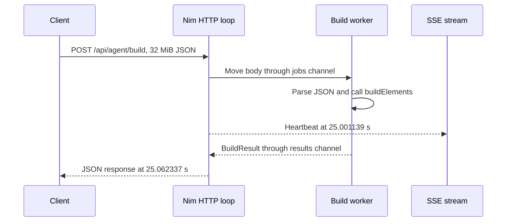
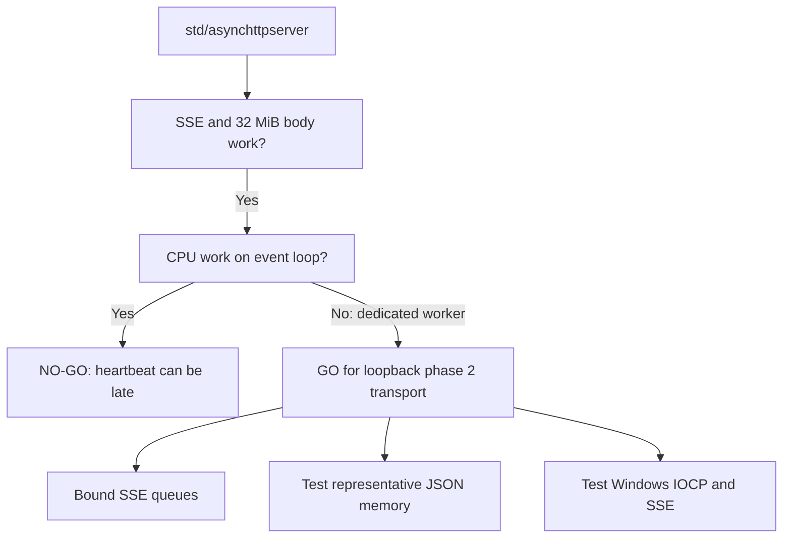

# HTTP and MCP spike

Status: PASS. Local decision record for the phase 2 HTTP transport.

Date: 2026-11-24

## Decision

Use `std/asynchttpserver` for the phase 2 loopback HTTP server. Keep JSON parsing and `buildElements` on one dedicated worker thread. Do not adopt Chronos for the tested workload.

The transport path is a go. Running CPU work on the HTTP event loop is a no-go.

## What worked

One native Nim process served all requested HTTP behavior without Node.

- Static JavaScript came from memory. Unknown non-API paths returned the in-memory `index.html`.
- SSE sent `retry: 2000`, a 25 second heartbeat, and pushed events to one client and ten concurrent clients.
- A 32 MiB JSON body returned 200 through `POST /api/agent/build`.
- A 32 MiB plus one byte body returned 413. Chunked requests returned 200 for a small body and 413 for an over-limit chunk.
- Stateless MCP HTTP handled `initialize`, `ping`, and `tools/list` with two fake tools.
- Malformed MCP JSON returned 400. Other MCP methods returned 405 with `Allow: POST`. Notifications returned 202.
- The server bound only `127.0.0.1`.
- The direct native process had no descendants and no Node descendants.

The spike imports `../../nim/core/elements.nim` directly. `server/core-worker.js` is the phase 1 Node bridge and is absent from this spike.

## Request flow



The heartbeat arrived 61.198 ms before the build response. The worker kept the event loop free while JSON parsing and the core build ran.

## Why the worker thread is required

The first implementation called the core from the async HTTP callback. Compilation failed because the callback must be GC-safe and this call chain reaches global state.

```text
handleBuild [1]
└── buildElements [1a]
    └── resolveBindings [1a1]
        └── patchElement [1a1a]
            └── measureText [1a1a1]
                └── METRICS global [1a1a1a]
```

A scoped `{.cast(gcsafe).}` made the event-loop version compile. The runtime result rejected that design. During a 32 MiB request, a static probe stalled for 130.274 ms. In the aligned SSE test, the heartbeat arrived at 25.099894 s and the response arrived at 25.089734 s. The heartbeat was late.

The final version moves the raw body through a `Channel[BuildJob]`. One worker parses JSON, calls `buildElements`, and returns `BuildResult` through another channel. The HTTP loop polls the result channel every 5 ms. Metrics load before the thread starts and stay read-only. The worker alone owns the core's mutable random state.

## Exact `std/asynchttpserver` limitations

These findings apply to Nim 2.2.14.

| Limitation | Consequence for phase 2 |
|---|---|
| The module documentation says it is not designed for production and recommends a reverse proxy. | Acceptable only because this server is loopback-only. Do not expose it directly to a network. |
| `Request.body` is a fully buffered string. The callback runs after the complete body arrives. | There is no streaming request-body API. A 32 MiB request holds the body in memory before dispatch. |
| `maxBody` defaults to 8 MiB. | The spike sets it to 33,554,432 bytes. Content-Length and chunked over-limit requests return 413. |
| `readTimeout` covers the request line, headers, body, and idle keep-alive time. It does not cover callback execution. | The spike sets 120 seconds. A slower upload gets 408. A running SSE callback has no read deadline. |
| `respond` adds `Content-Length`. There is no SSE or chunked-response helper. | SSE uses raw socket headers and writes. The server must manage heartbeats, disconnects, and pending reads itself. |
| Async callbacks must be GC-safe. The core reaches global metrics and random state. | The core cannot run directly in the callback without a cast. The dedicated worker is the honest boundary. |
| Synchronous CPU work inside a callback blocks the event loop. | JSON parsing, serialization, geometry, inspection, gzip, and file work must stay off-loop. |
| The standard server provides no middleware, routing, auth, TLS, HTTP/2, or bounded SSE queues. | Phase 2 must add those pieces it needs. The spike's SSE queue is unbounded and is not production policy. |

Chunked request decoding and HTTP/1.1 keep-alive worked in this version. No transport failure required Chronos. Chronos would not fix the observed `std/json` memory cost.

## Measured numbers

Measurements used Nim 2.2.14 on macOS 27.2.1, arm64. The release binary is 703,304 bytes. The 32 MiB workload is valid JSON with one rectangle spec and a large padding string, so the timing is dominated by body transfer and JSON parsing rather than geometry.

| Measurement | Result |
|---|---:|
| First direct startup | 5.978 ms |
| Warm startup p50, six runs | 5.304 ms |
| Warm startup p95 | 6.259 ms |
| Idle RSS | 7,280 KiB |
| Static p50, 200 requests | 0.090 ms |
| Static p95 | 0.144 ms |
| Static max | 0.178 ms |
| 32 MiB build total | 167.476 ms |
| 32 MiB build after body send | 131.967 ms |
| Event loop probe p95 during build | 0.755 ms |
| Event loop probe max during build | 17.873 ms |
| Peak RSS after 32 MiB build | 402,816 KiB |
| RSS after build | 402,816 KiB |
| Paced upload duration | 31.657824 s |
| SSE heartbeat during paced upload | 25.001610 s |
| Aligned build start | 24.910290 s |
| Aligned heartbeat | 25.001139 s |
| Aligned build response | 25.062337 s |
| Concurrent SSE clients | 10 |
| Concurrent SSE heartbeats | 10 |
| Heartbeat delay p50 after fanout | 24.747625 s |
| Heartbeat delay max after fanout | 24.748601 s |
| Node descendants | 0 |

Peak RSS is 393.38 MiB for a 32 MiB JSON body. This is the largest measured risk. The allocator did not return that memory after the build. A real scene with many JSON nodes may cost more or less, so phase 2 needs a representative memory test before it commits to `std/json` at the API boundary.

## Go or no-go



Go for `std/asynchttpserver` as the phase 2 transport. Keep the worker-thread requirement. Add bounded queues before production. Treat the 393 MiB peak as a gate for the real scene corpus. Chronos remains unnecessary unless a later Windows or streaming requirement exposes a transport limitation that costs more to work around than the dependency.

## Riskiest Windows unknown

The riskiest unknown is Windows IOCP behavior for a long-lived SSE socket with a pending `recv`, heartbeat writes, and a concurrent 32 MiB request handled by the worker thread.

The spike detects SSE disconnects with a pending one-byte `recv`. Windows must prove that closing the client promptly completes that pending operation, releases the socket, and does not leak IOCP state. The same test must show that heartbeat writes remain timely while the worker parses a 32 MiB body. Windows thread startup, channel handoff, and ORC shared-heap behavior also need a native CI run.

## Scope limits

This spike does not implement or prove vault storage, history, auth, real MCP tools, stdio MCP, full MCP conformance, rendering, TLS, or production hardening. It proves the requested HTTP slice and the need for an off-loop core worker.

## Reproduce

Run the commands in `spike/http/README.md`. The captured output is `spike/http/results.json`.
