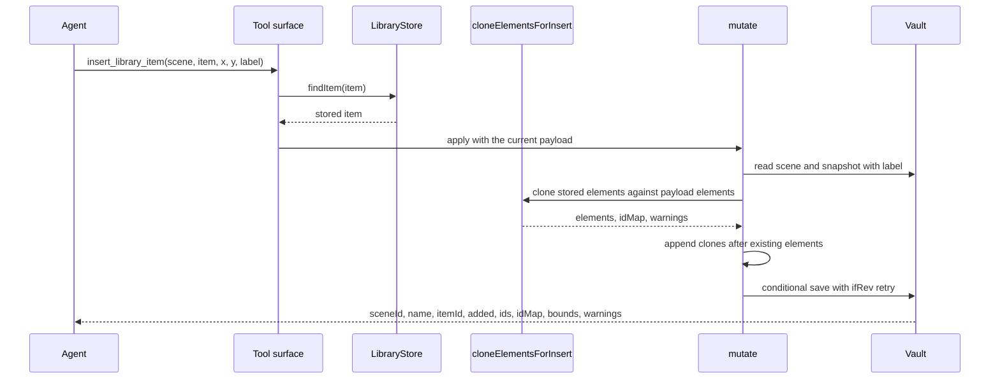
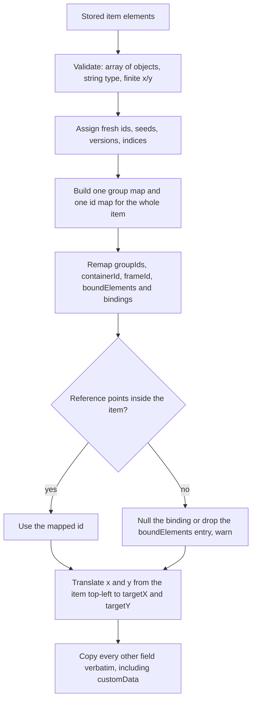

# Using an installed library item

An installed item is data in `library.excalidrawlib`. Placing it is a scene write.
The two operations share no state: the store is read, the clone is pure, and the
scene is saved through the same `mutate` path as every other write.

## Placement

## Remap

Validation raises `ValueError`. Ambiguous item lookup raises a 400 with candidate
ids and names. An unknown item raises a 404. A second insert clones again, so it
never reuses the ids of the first. The library file is never written by a read or
an insert.
