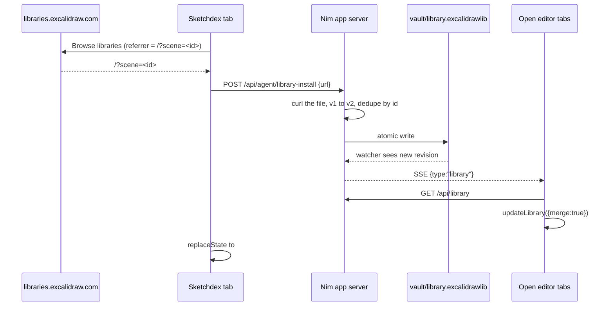
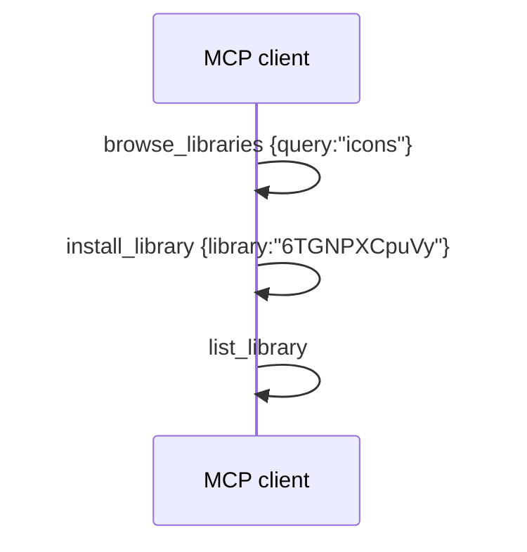

# Libraries

The app has an Excalidraw library panel. Until now it was browser state only:
items lived in `localStorage`, and clicking Install on
libraries.excalidraw.com opened the app at `#addLibrary=<url>` where the hash
meant nothing, so the install vanished. The agent had no library at all.

The vault becomes the truth for library items, the same way it is for scenes.

## Data

One file at the vault root, in Excalidraw's own format, so it also opens in
excalidraw.com:

```json
{
  "type": "excalidrawlib",
  "version": 2,
  "source": "sketchdex",
  "libraryItems": [
    {
      "id": "3f9c...",
      "status": "unpublished",
      "created": 1764000000000,
      "name": "server",
      "elements": [{ "type": "rectangle", "..." : "..." }]
    }
  ]
}
```

Installed libraries are source files in version 1 (`"library": [[elements]]`)
or version 2 (`"libraryItems": [{id, status, elements, created}]`). Version 1
entries have no id, so install mints one. Items are appended by id, which makes
a second install of the same library a no-op instead of a duplicate.

The catalog is `https://libraries.excalidraw.com/libraries.json` (232 entries,
about 200 KB): `{id, name, description, authors[], source, preview, updated}`.
A library file is `https://libraries.excalidraw.com/libraries/<source>`.
The server fetches both with `curl`, the same tool `sketchdex update` already
depends on, so the binary keeps no TLS dependency.

## Install paths





## Surface

| Surface | Call | Answers |
|---|---|---|
| MCP | `browse_libraries` | catalog search: id, name, description, authors, preview |
| MCP | `install_library` | catalog id or direct `.excalidrawlib` URL, appended to the vault |
| MCP | `list_library` | installed items with element counts |
| REST | `POST /api/agent/library-browse`, `library-install`, `library-list` | the same |
| App | `GET /api/library` | `{rev, items}` |
| App | `PUT /api/library` | `{items, ifRev}` replace, 409 on a stale rev |

The app is the only writer that deletes items, so its write is a replace
guarded by `ifRev`; on 409 it refetches, merges by id and writes again. The
agent only appends, so concurrent installs commute.

## What the editor does

- `initialData.libraryItems` comes from `GET /api/library`, so the panel is
  filled on the first paint with no flash of an empty library.
- `onLibraryChange` posts the full set back after a short debounce. A signature
  of `id:sceneVersion` skips the echo of a set that just came from the server,
  which is what stops a write loop between tabs.
- On the SSE `library` event the editor refetches and merges, so an install by
  the agent shows up in an open panel.
- `libraryReturnUrl` is `origin + pathname + "?scene=<id>"`, so the catalog's
  Install button comes back to the scene the person was editing.
