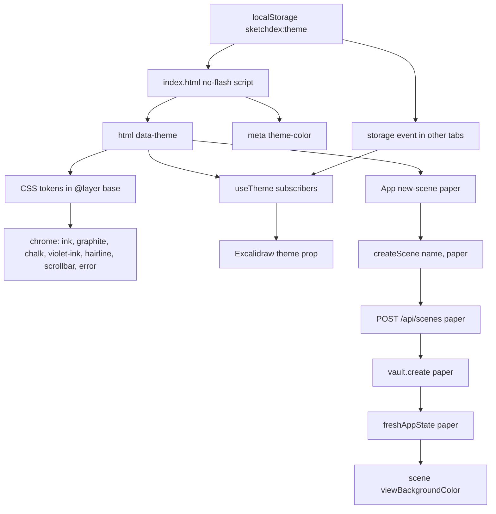

# Light theme

The chrome theme is a preference. Canvas colours are authored data.

| Mode | New app scene paper | Default ink |
| --- | --- | --- |
| light | `#ffffff` | `#1e1e1e` |
| dark | `#121212` | `#e9ecef` |

Rules:

- Existing scenes keep their `viewBackgroundColor`. The theme never writes a
  scene file.
- Agent and MCP callers omit `paper`, so their new scenes stay dark.
- The canvas filter is off in both themes. No pixel is inverted.
- Exports read scene data, not chrome, so output stays byte-identical.
