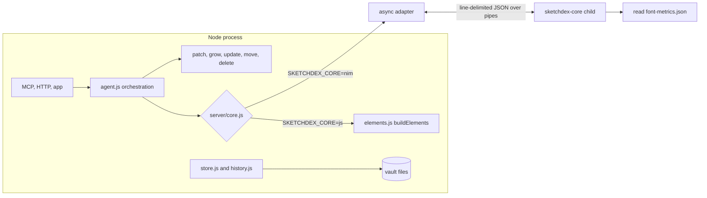
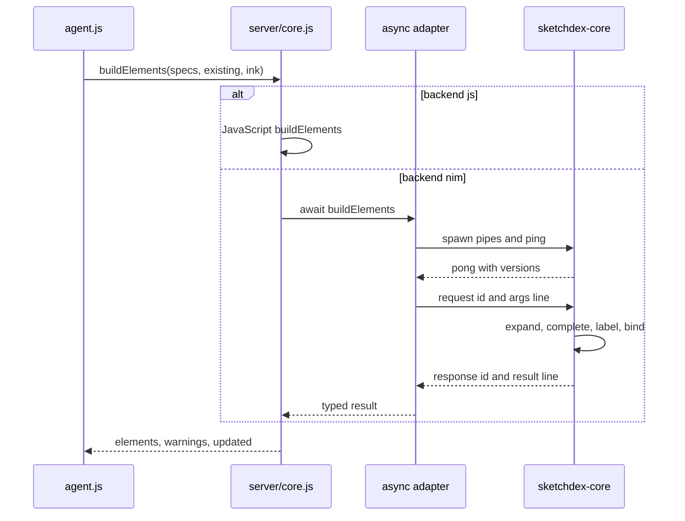
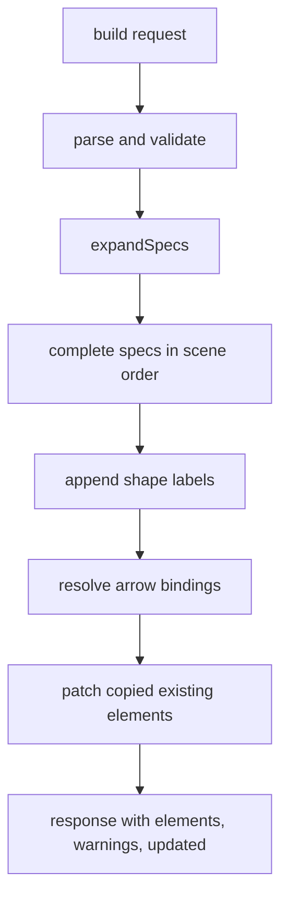
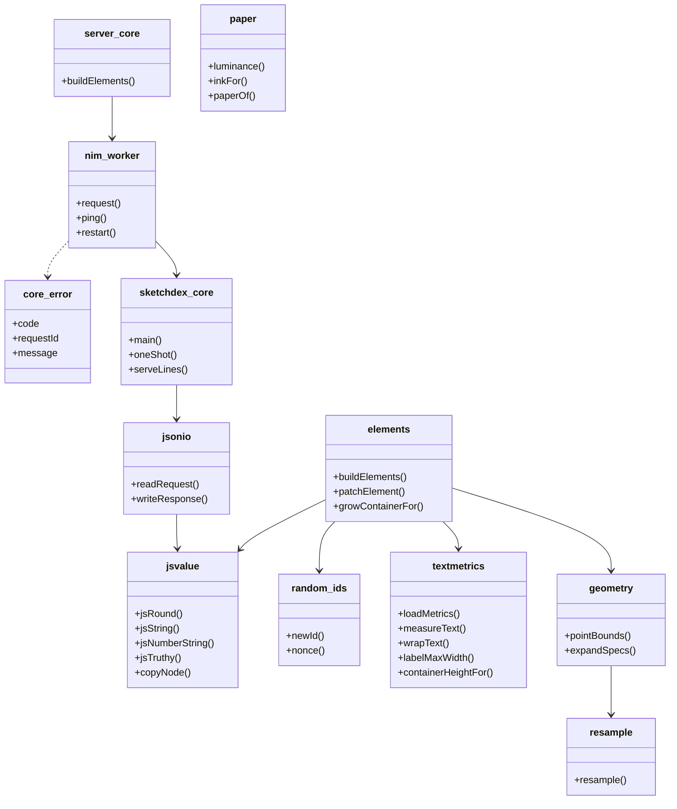
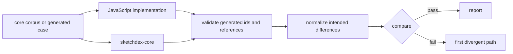
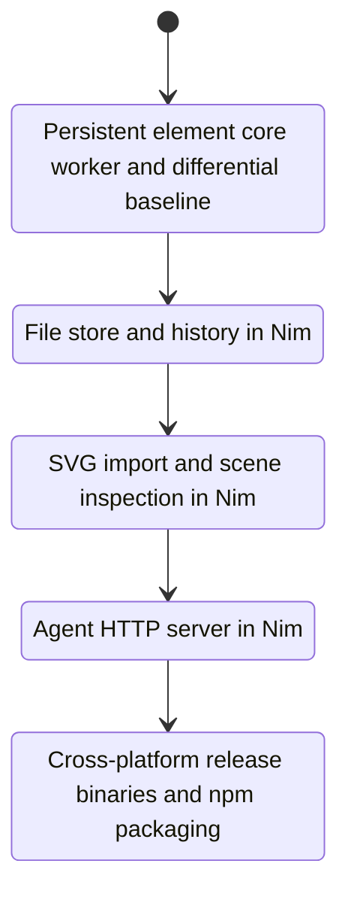

# Nim core: phase 1 design

Status: phase 1 implemented. Later phases proposed.

## Verdict first

Nim 2.2.14 is pinned in `mise.toml`. Go and Rust are rejected. The rewrite is multi-phase. Phase 1 is the element core.

Phase 1 delivers parity and a measured core, not a whole-server RSS win. Node owns the vault and agent orchestration. JavaScript remains the default.

## What phase 1 covers

| Module | Phase 1 | Boundary |
|---|---|---|
| `server/elements.js` | Port | `buildElements`, `patchElement`, and `growContainerFor` |
| `server/geometry.js` | Port | Primitives, repeat, mirror, and bounds |
| `server/sketch.js` | Partial port | `resample` only. `fillFor`, `snapStrokeWidth`, and `sketchLine` stay JavaScript. |
| `server/paper.js` | Port | Luminance, paper, and default ink |
| `server/font-metrics.json` | Read only | Same measured table |
| `server/svg.js` | No | Phase 3 |
| `server/store.js` | No | Phase 2 |
| `server/history.js` | No | Phase 2 |
| `server/inspect.js` | No | Phase 3 |
| `server/agent.js` | Adapter only | Orchestration stays in Node |
| MCP and rendering | No | Stay in Node |

Only `buildElements` uses Nim when `SKETCHDEX_CORE=nim`. `patchElement` and `growContainerFor` are pure Nim functions tested separately. The agent calls JavaScript, and `update`, `move`, and `delete` stay JavaScript to avoid a second source of truth.

`fillFor` is not part of phase 1. The Nim CLI never calls or tests it, and its empty-string behavior differs from `server/sketch.js`. It stays JavaScript with `snapStrokeWidth` and `sketchLine`.

## Architecture

`server/core.js` selects the backend. The child starts lazily with piped stdio and never inherits handles. Parent exit kills it. The metrics path is explicit. Nim reads no other file.

The async adapter correlates requests by id, times out after 30 seconds, and raises typed `CoreError` with code, request id, message, and capped stderr. There is no `maxBuffer`.

A crash rejects pending requests. The next request starts a fresh child after a version `ping`. One-shot mode serves tests and benchmarks, not production.

## Domain model

The protocol exposes `ping` and `build`. The adapter validates JSON. The core returns typed results or errors.

`patchElement` supports bindings inside `buildElements`. `growContainerFor` is a pure test helper. Neither is an agent RPC.

## Module map

## Element invariants

- Every expanded spec consumes an index before explicit `index` validation. A valid explicit index wins, but the candidate is consumed.
- Labels consume indexes. Deleted elements in `existing` still contribute indexes.
- Shapes and labels are pushed in scene order.
- Binding precedence is ref, built id, then live existing id. Deleted elements never bind.
- `fontFamily` stays numeric. Metrics use the ECMAScript number string as the key. `5.5` misses the table and uses the heuristic. Never cast to an integer.
- `jsRound` follows ECMAScript exactly, including `0.49999999999999994` and negative halves.
- Random ids and nonces use entropy when `rng` is absent. A fixed default seed is a bug.
- Curves keep the hand-drawn contract. Use roughly 18 pixel anchors, roundness type 2, roughness 1, and solid fill by default.

## The baseline

`test/core/differential.mjs` compares 165 hand-written core cases and 500 generated cases after identity validation and normalization.

Another 22 hand-written `update`, `move`, and `delete` cases are JavaScript-only agent orchestration. They do not run against Nim. `test/core/nim-path.test.mjs` covers the real Nim-backed agent path. The differential count is 665, not 187.

| Field | Rule |
|---|---|
| Input ids | Preserve exactly. Never remap. |
| Generated ids | Validate 21 character shape, allowed alphabet, uniqueness, no input collision, and reference integrity. Then remap in traversal order. |
| Copied numbers | Compare exactly. |
| Computed geometry | For non-integers, allow `abs(a - b) <= 1e-8 * max(1, abs(a), abs(b)) + 2e-7`. The floor covers cancellation from large repeat or offset coordinates. Integers stay exact. |
| `updated` | Inject the same fixed `now` into both sides. Override `Date.now` in the JavaScript harness. Compare exactly. |
| `versionNonce` | Compare type, range, and placement invariants, not value. |
| Generated `seed` | Compare nonce range and placement invariants, not value. Supplied seeds stay exact. |
| Warnings | Compare full strings. Only the two known V8 message cases use prefixes. |
| Object key order | Ignore. |

The two prefix cases begin with `skipped an entry with no "type" field` and `could not build`. Every other warning must match exactly.

The `test:core` gate runs five suites.

1. Nim unit tests for helpers, ECMAScript edges, metrics keys, and ids.
2. The 165 core and 500 generated differential cases.
3. `test/core/adapter.test.mjs`, with 21 lifecycle tests.
4. `test/core/normalize.test.mjs`, with 11 comparison tests.
5. `test/core/nim-path.test.mjs`, covering persistence and history on the real Nim-backed agent path.

`npm test` still drives the packaged JavaScript product, unchanged.

## Performance protocol

One-shot Nim loses to V8 on small operations because startup dominates. The persistent worker can win.

The benchmark runs JavaScript, persistent Nim, and one-shot Nim sequentially on five workloads. `e2e` gets 100 warmups. The other four get 20. Each backend and workload runs 10 sequential batches of 10 operations. P50 and batch p95 use linear interpolation over the 10 batch means. Operations per second comes from p50. Trials are not interleaved.

RSS is cold one-shot Nim only. With `/usr/bin/time -l`, it records 20 launches per workload and reports median maximum RSS in MiB. It excludes persistent-worker and combined process RSS. The report includes machine facts, workloads, parity, and timings.

CI gates parity, not speed. Hardware variance rules out a hard threshold.

## Delivery and CI

The Nim binary stays out of the npm `files` list. The default install and runtime remain JavaScript-only.

One Ubuntu CI job installs Nim with mise, builds the core, and runs `test:core`. The existing OS and Node matrix and `npm test` stay unchanged.

## Risks

| Risk | Handling |
|---|---|
| Float drift in generated points | For non-integers, use `1e-8 * max(1, abs(a), abs(b)) + 2e-7`. The floor covers cancellation from large coordinates. Copied values and integers stay exact. |
| JavaScript coercion and number keys | Test strings, truthiness, `jsRound`, and font keys. |
| Random identity defects | Validate shape, uniqueness, collisions, and references. |
| Worker lifecycle bugs | Test timeout, restart, handshake, stderr caps, and parent exit. |
| Binary distribution | Keep the binary out of npm until phase 5. |
| Performance overclaim | Publish the implemented protocol and make no CI speed gate. |

## Phases after this PR

Each phase starts after the previous done predicate is green. Later phases inherit the worker, parity rules, and measurements.

## Review findings folded in

1. Pin Nim 2.2.14 in `mise.toml`. Reject Go and Rust. Phase 1 is the element core.
2. Port `elements.js`, `geometry.js`, sketch resampling, and `paper.js`. Keep `fillFor`, `snapStrokeWidth`, and `sketchLine` in JavaScript. Other server layers stay Node.
3. Wire only `buildElements` behind `SKETCHDEX_CORE=nim`. Keep `patchElement` and `growContainerFor` pure in Nim but JavaScript in the agent path.
4. Use a persistent JSON-lines child with an async adapter, request ids, 30 second timeout, typed `CoreError`, capped stderr, crash restart, and version ping. One-shot mode serves tests and benchmarks. Pass metrics explicitly. No `maxBuffer`.
5. Spawn lazily, pipe all stdio, and kill on parent exit. Node owns the vault. Nim reads only `font-metrics.json`.
6. Preserve input ids, remap generated ids, validate identity and references, fix `now`, compare nonce invariants, keep copied numbers exact, and tolerate only computed drift.
7. Treat index consumption, label indexes, deleted existing indexes, scene order, and binding precedence as invariants.
8. Seed RNG from entropy when `rng` is absent. A fixed default seed is a bug.
9. Keep `fontFamily` numeric. `5.5` uses the heuristic. Implement exact ECMAScript `jsRound`.
10. State the one-shot cost honestly. Use sequential batch means and cold one-shot RSS, with no hardware-sensitive CI threshold.
11. Keep the binary out of npm `files`. Add one Ubuntu mise job for the core build and `test:core`. Leave the main matrix and `npm test` unchanged.
12. Put the persistent worker in phase 1, store and history in phase 2, SVG and inspection in phase 3, the agent HTTP server in phase 4, and release binaries in phase 5.

## Done predicate

All 165 core cases and 500 generated cases pass the baseline. All 22 agent-only cases pass on the JavaScript path. The Nim-backed agent path passes `test/core/nim-path.test.mjs`. `test:core` passes, including 21 adapter tests, 11 normalization tests, and Nim unit tests. Generated ids satisfy identity and reference checks. The packaged JavaScript end-to-end test passes. The Ubuntu Nim job is green, and the benchmark report contains timing and cold RSS measurements. No other server layer has moved.
