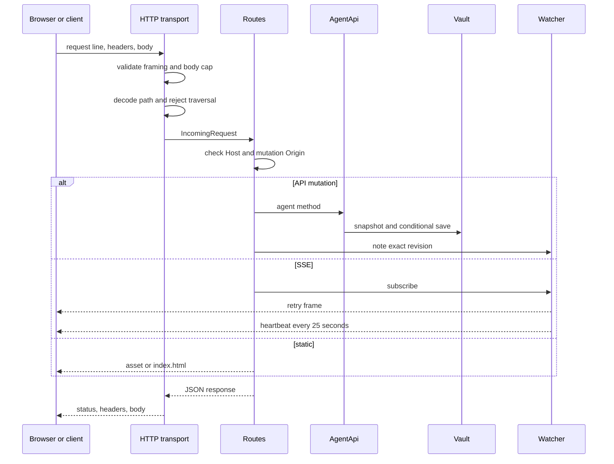

# Nim HTTP server design

## Goal

One Nim process serves the built UI, the vault REST API, SSE, and MCP over HTTP. The same binary also runs MCP over stdio and prints the manual.

The done predicate is an end-to-end test against the compiled binary. It covers static files, SPA fallback, vault CRUD, an agent build, SSE headers and a heartbeat, MCP initialize, error shapes, security guards, and the absence of a Node child process.

## Constraints

- `nim/server/agent.nim`, `nim/mcp/rpc.nim`, `nim/server/vault.nim`, and `nim/server/svg.nim` are being completed by another worker. The HTTP code uses `newAgentApi`, `api.vault`, the agent scene methods, and `handleMcpRequest(body, dispatcher)` as the integration contract.
- The current vault slice still lacks the store methods used by import, patch, duplicate, and thumbnail routes. Those symbols remain compile dependencies.
- The server binds only `127.0.0.1`.
- The default request body cap is 32 MiB. `--max-body` and `SKETCHDEX_MAX_BODY` override it.
- No route starts a child process.

## Transport choice

`std/asynchttpserver` reads the body before it calls the route. Its built-in 413 response is plain text, so it cannot satisfy the JSON error contract. A small HTTP/1.1 transport in `nim/server/http.nim` reads framing first, rejects an oversized `Content-Length` before allocation, and enforces the same cap while reading chunked bodies.

Normal responses use `Content-Length` and close the connection. SSE uses chunked transfer encoding and keeps the connection open. This avoids a persistent-connection parser while preserving browser streaming behavior.

## Types

```nim
IncomingRequest*
  method*: HttpMethod
  target*: string
  path*: string
  parts*: seq[string]
  headers*: Table[string, string]
  body*: string
  client*: AsyncSocket

HttpFailure* = object of CatchableError
  status*: int
  allow*: seq[string]

SseClient* = ref object
  socket*: AsyncSocket
  pending*: seq[string]
  closed*: bool

WriteNote* = object
  by*: string
  at*: MonoTime
  rev*: Option[string]

Watcher* = ref object
  api*: AgentApi
  clients*: seq[SseClient]
  recent*: Table[string, WriteNote]
  observed*: Table[string, string]
  announced*: Table[string, string]
  pending*: Table[string, PendingChange]
  closed*: bool

HttpServer* = ref object
  socket*: AsyncSocket
  api*: AgentApi
  watcher*: Watcher
  assetsDir*: string
  maxBodyBytes*: int
  port*: Port
  url*: string
```

## Request flow



## Route ownership

`nim/server/http.nim` owns transport, guards, route dispatch, static serving, and SSE. `nim/cmd/sketchdex.nim` owns argument parsing, asset and metrics discovery, process startup, stdio framing, and version output.

The watcher polls scene revisions every 250 ms. It debounces changes for 120 ms. A write note matches an exact revision when present. A note without a revision keeps the existing 2.5 second fallback. External edits call `api.noteExternalChange` before the server emits the history event.

## Verification

`nim/tests/test_http.nim` starts `/tmp/sketchdex app` with a scratch vault, temporary assets, an ephemeral port, and a 1 KiB body cap. It drives the real process over HTTP and a raw socket. The same test runs `--version`, `docs`, and `mcp`.
