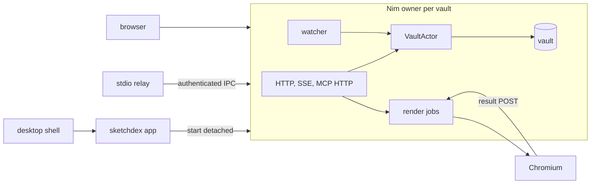
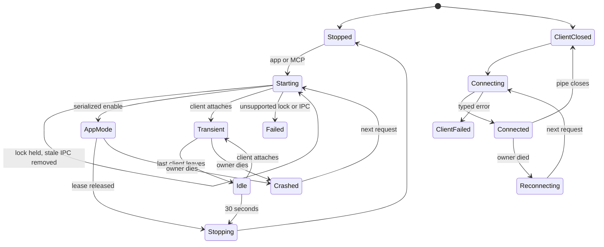
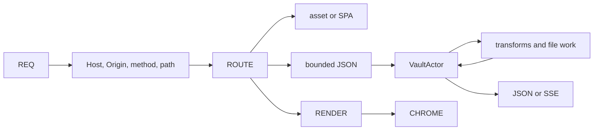
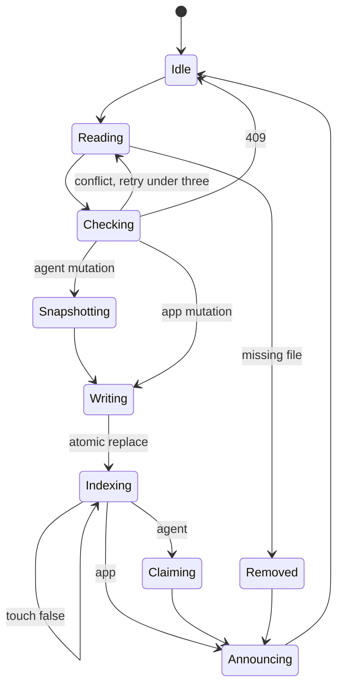

# Nim server design

Status: revised, spike-blocked. Supersedes Node phases in `nim-core.md`. Phase 1 is core.

## Decision and runtime guarantee

Ship one native `sketchdex` binary for HTTP, static UI, sync, MCP, CLI, docs, history, agents, and rendering. React and Excalidraw stay in `dist/`. Chromium is the only external render process.

The native server starts no Node descendant after installation. npm and npx may run Node first. An npx tree is not Node-free.

Run `sketchdex mcp` after `npm install -g sketchdex`, or `sketchdex app`. Direct releases use `/path/to/sketchdex mcp` or `/path/to/sketchdex app`. MCP config uses command `sketchdex`, arguments `["mcp"]`. Convenience `npx -y sketchdex@latest mcp` has an npm Node parent.

## Process model

No client owns the process. `sketchdex app` starts an app-mode owner and leases it while serving UI. `sketchdex` connects over IPC. Without an owner, it starts a transient owner that exits after 30 idle seconds without clients or an app lease. Closing one client leaves others intact. Owner death returns a typed error. The next request starts another.

## Owner and client lifecycle

Canonical identity uses `realpath`, nearest existing ancestor for a missing vault, Windows final path and case normalization, and volume identity. POSIX contributes `st_dev`. Windows contributes volume serial. Hash the tuple into a per-user runtime lock name, never the vault. Hold an OS lifetime `flock` or `LockFileEx`. Stale lock files are harmless. Never break a live lock using PID or boot metadata.

IPC uses the same hash. Unix sockets need owner-only permissions. Windows pipes need a current-user DACL and random token. Serialize app-mode enable through startup. Remove IPC only after holding the lock and proving its owner is gone.

Test symlink, alias, junction, case and UNC variants, two vaults, deleted vaults, crash, stale IPC, SMB, and NFS. Unproven network locking fails closed. A deleted vault keeps its lock, rejects writes, and adopts recreation.

## HTTP stack and request flow

| Option | Fit | Decision |
|---|---|---|
| `std/asynchttpserver` | Built in, Windows, keep-alive, body cap, deadlines, chunked requests. Manual SSE and streaming. | Start here. |
| `chronos` | SSE, streaming, middleware, process I/O, Windows IOCP, extra dependencies. | Fallback after spike. |
| `jester` | Routes and disk static files. Embedded assets and SSE remain custom. | Reject. |

Phase 2 starts with `std/asynchttpserver` and a configurable body reader. Default cap is 32 MiB. JSON, SVG, inspection, geometry, gzip, and file work run off-loop. SSE queues are bounded.

The HTTP spike proves SSE, chunked and streaming responses, static files, 32 MiB bodies, Windows, and a 32 MiB save while 25 second heartbeats continue. Adopt Chronos only if a recorded limitation costs more code than the dependency. Name the failure and rerun.

Harden security intentionally. Parse loopback hosts and ports strictly. Validate Origin scheme, host, and port. Keep missing Origin for non-browser callers. Guard static files by Host. Reject malformed escapes and traversal. Empty bodies still bypass content-type checks.

## Route parity contract

Generate the baseline from the Node server before implementation. Record status, headers, normalized body, static bytes, HEAD, OPTIONS, trailing slashes, encoded paths, and SPA fallback for every route and method. Phase 2c requires zero diff except approved hardening.

| Family | Current contract |
|---|---|
| `/api/vault` | GET `{vault}`. Other methods use SPA. |
| `/api/events` | Every method opens SSE. |
| `/api/agent` | Every non-POST returns `{ops}`. POST runs `list`, `describe`, `read`, `elements`, `path`, `create`, `add`, `update`, `delete`, `move`, `replace`, `write`, `background`, `snapshot`, `svg`, `check`, `history`, `restore`, `discard`, `clear`. |
| `/api/scenes` | GET list. POST create or import. Others 405. |
| `/api/scenes/:id` | GET read with `rev`. PUT conditional save. PATCH metadata. DELETE history then trash. Others 405. |
| `/api/scenes/:id/history` | GET `{entries,bytes}`. DELETE `{entries:[]}`. |
| `/api/scenes/:id/history/:snap` | GET `{elements,appState}`. DELETE `{entries}`. |
| `/api/scenes/:id/history/:snap/restore` | POST mutation result. |
| `/api/scenes/:id/thumb` | GET `{svg}`. PUT `{ok:true}`. |
| `/api/scenes/:id/duplicate` | POST metadata or `null`. |
| `/mcp` | POST JSON-RPC or 202. GET SSE. DELETE 200. Others 405 with `Allow`. |
| `/mcp/`, unknown `/api/*`, static | SPA. Static accepts all methods. |

| Edge | Baseline | Decision |
|---|---|---|
| Unknown API, non-GET vault, all-method events, non-POST agent | SPA, SSE, or ops as above | Keep |
| `OPTIONS /api/scenes` | 405 without `Allow` | Keep |
| Unknown scene subpaths | Ignored, parent route runs | Keep |
| Empty body, undecoded API segments | Bypass type check, raw segments | Keep |
| Malformed static escape | Plain-text 400 | Keep |
| Static validators | None | Harden with ETag and cache policy |
| Errors | `{error}`. Conflict adds `code` and `rev`. Outer 500 empty. | Keep first two, harden outer 500 |
| SSE | `text/event-stream`, `no-cache, no-transform`, `keep-alive`, `retry: 2000` | Keep |
| JSON type | Bare `application/json` | Keep |
| MCP errors | Middleware `{error}` 400. SDK 406, 405 with `Allow`, 202. | Keep |
| Body cap | None | Harden with configurable 32 MiB and 413 |

## Vault state machine

Keep current semantics. `ifRev` permits creation when the file is missing. `touch:false` skips index updates. Valid stale indexes are not rebuilt. `patchIndex` does not add missing scenes. Revisions use ECMAScript number formatting. Agent writes snapshot once, retry three times, preserve `files`, and claim the exact revision.

History keeps 20 gzip snapshots, excludes `files`, uses 16-character hex ids, reports compressed bytes, and never expires claims. Match Node gzip output. Deletion clears history before trash. The previous-state cache holds five scenes.

Keep watcher behavior. It starts on first subscribe, debounces 120 ms, uses a 2.5 second fallback, does not deduplicate by revision, and stops after a watch error until resubscription. Bounded queues and slow-client drops are hardening.

Atomic replace adds flush, directory sync, Windows write-through, and startup temp cleanup. Test delete-and-recreate, stale indexes, fractional mtimes, same-size writes, and retry exhaustion.

## MCP and render

Native MCP implements version negotiation, batches, notifications, cancellation, protocol headers, `initialize`, `ping`, tools, and resources. HTTP stays stateless with JSON responses. Preserve 120 KiB text and 150 KiB image ceilings, spilling, 19 schemas, instructions, seven resources, and errors. Keep permissive required-key checks. `sketchdex_info` uses `runtime:"nim"`. Shipped stdio drops hot reload and `tools/list_changed`.

The official SDK client must pass stdio and HTTP for every supported version, malformed and batched JSON-RPC, notifications, cancellation, pipe close, and owner crash.

Render discovery includes Chrome, Chromium, Edge, Brave, Vivaldi, and Chrome Canary. The token-authenticated loopback listener serves all embedded `dist/` assets. Keep the `text/plain` callback and 128 MiB limit. Use a process group or Windows job object, kill the tree, and await listener and profile cleanup. Crops and tiles stay in `src/render.ts`. Excalidraw canvas export and fonts cannot live in Nim. Electron is not a render fallback.

## Node runtime inventory

| Runtime location | Current Node use |
|---|---|
| `bin/sketchdex.js` | Shebang, args, env, streams, imports, opener |
| `server/serve.js`, `middleware.js` | HTTP, static SPA, routing, security, SDK, SSE |
| `server/store.js`, `history.js`, `watch.js` | Filesystem, gzip, UUIDs, `fs.watch`, timers |
| `server/agent.js` | Runtime orchestration |
| `server/elements.js`, `geometry.js`, `sketch.js`, `svg.js`, `inspect.js`, `paper.js` | Runtime modules. `elements.js` uses `node:crypto` and metrics. |
| `server/core.js`, `core-worker.js` | Phase 1 Node adapter and Nim child |
| `mcp/server.js`, `worker.js` | Stdio, SDK, fork, IPC, watcher |
| `mcp/tools.js`, `docs.js` | Schemas, filesystem, process info, render, docs |
| `mcp/render.js`, `render-main.js` | HTTP, filesystem, spawn, npm build, Electron |
| `electron/main.js` | Node main imports Node server |

The only declared npm runtime dependency is `@modelcontextprotocol/sdk`. Its Node closure leaves with it. `electron` is a devDependency but runs the optional shell. React, React DOM, Excalidraw, and `idb-keyval` are bundled into `dist/`.

Build and test Node stays in `scripts/build-core.mjs`, `check-package.mjs`, `measure-fonts.mjs`, `patch-excalidraw.mjs`, Vite, Tailwind, TypeScript, oxlint, electron-builder, concurrently, wait-on, types, and tests. Registry installs must not run the Node `prepare` patch.

## Packaging and size

Measured here: `dist/` is 8.1 MiB, tarball 2.74 MB, unpacked 8.41 MB. Electron is roughly 150 to 250 MiB installed.

Target a stripped native binary at or below 8 MiB with compressed embedded assets and no Chronos. Embed precompressed assets, docs, metrics, schemas, and gzip with generated `staticRead`. Keep `--assets <dir>` for development.

Use one root bin, `bin/sketchdex.exe`, on all platforms. Install stages a tiny native launcher. Platform packages carry payload only, with no public bin. An install-time Node script selects the optional package. `--omit=optional` and `--ignore-scripts` fail with a clear unsupported-platform error.

The smallest proof packs root plus Windows x64 and tests global install, npx, omitted optionals, monorepo, and direct binary. Bare `npx sketchdex` in a monorepo may select a stale local package. Use `npx -y sketchdex@latest mcp` or direct.

Build on native macOS, Linux, and Windows runners. Provide musl and glibc Linux variants. Sign and notarize macOS, Authenticode-sign Windows, and publish Linux checksums, SBOM, and provenance. GitHub Releases carry binaries.

Electron is a separate optional shell. It launches the native owner from `extraResources`. WKWebView, WebView2, or WebKitGTK require native window, menu, dialog, update, and deep-link work.

## Spikes and parity harness

Four spikes precede implementation. Each launches a native test binary directly and inspects its process tree for Node descendants.

- Lock and IPC: aliases, junctions, two vaults, deleted vault, crash, stale endpoint, SMB, NFS.
- HTTP: workload and Chronos gate above.
- MCP: official SDK conformance over stdio and HTTP.
- Launcher: packed root, Windows x64, global install, npx, omitted optionals, monorepo, direct binary.

Reuse `test/e2e.mjs` through an adapter. Run Node, reset the scratch vault, then run Nim. Never point both at one live vault. Compare route matrix, MCP transcripts, SSE order, CLI goldens, and files. CLI goldens cover flags, exits, port scan, opener, docs, and version. Normalize ids, timestamps, revisions, paths, PIDs, and uptime. Compare gzip after deterministic decompression. Add near-cap images, concurrent save, external edit, crash restart, malformed URL, and slow SSE.

## Phases

Native gate means direct launch plus no Node descendant.

| Phase | Landable units | Riskiest unknown | Gate |
|---|---|---|---|
| 1. Element core | Core entry, tests, benchmark | ECMAScript parity | Build and differential pass. Core tree has no Node. |
| Pre-2 spikes | Lock and IPC, HTTP, MCP, launcher | Windows ownership, aliases, network mounts | All pass first. |
| 2a. Storage and history | Native test mode, store, history, watcher | Windows replace, gzip | Matrices pass. Native gate passes. |
| 2b. Ownership and IPC | Owner, leases, relay, recovery | Second writer | App plus two clients. Close one, kill owner, test stale IPC, aliases, two vaults, networks. Native gate passes. |
| 2c. HTTP and static | Routes, SSE, assets, body cap | 32 MiB save with SSE | Route matrix and HTTP spike pass. Native gate passes. |
| 2d. App entry and default | App, ports, opener, checkout default | Shutdown | `sketchdex app` serves UI and exits cleanly. Native gate passes. |
| 3. MCP, CLI, tools, docs | Transports, CLI, schemas, resources | SDK-free lifecycle | SDK matrix and CLI goldens pass. Native gate passes. |
| 4. Render | Discovery, listener, process tree, tiles, cleanup | Image parity, child cleanup | Corpus passes. Chromium is the only render descendant. |
| 5. Packaging and release | Platform packages, launcher, signing, publish | Windows npm resolution | Packaging proof and signatures pass. Direct binary starts no Node descendant. |
| 6. Optional desktop | Owner launch, windows, updates, webview | WebView compatibility | Desktop parity. Server child starts no Node descendant. |

Phase 5 switches the published default after phases 2a through 4 pass.
