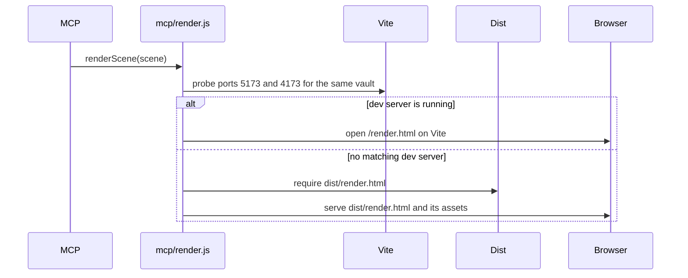

# Nim UI serving feasibility

## Decision

Recommend A. Keep the Vite build and let Nim serve `dist/` as static files. Production needs no Node. Node remains a development and CI dependency only.

A self-contained Nim server with no production build is achievable when `dist/` is a release artifact. A repository that never builds the UI is not achievable cleanly for the current code. Option B is technically possible, but it requires a broad rewrite, a large vendor tree, a second copy of the Excalidraw patch, and a new offline font path. That cost buys no user benefit. Close the no-build UI idea.

## Rules and method

Reject browser-side Babel, runtime TSX transforms, Tailwind CDNs, and network CDNs at runtime. They move compilation or network access into every page load. They break offline use, complicate CSP, and produce no checked release artifact. Option C is rejected.

Offline here means the local Nim server and vault are available while the internet is not. `public/sw.js` deliberately does not cache the shell, so this is not a server-free static page.

I read every requested file. Three read-only subagents were requested, but the host rejected all three with `Subagent depth limit reached (1)`. Direct probes replaced them. All probe files and build copies live under `/tmp/swarm-no-build-ui/`. No repository source file was changed.

## Current UI inventory

The TypeScript compiler AST gives these counts.

| Area | Files | Physical lines |
|---|---:|---:|
| TSX | 10 | 2,041 |
| TS | 7 | 800 |
| Total TS and TSX | 17 | 2,841 |
| `src/index.css` | 1 | 359 |

The 2,041 TSX lines are `main.tsx`, `App.tsx`, and eight component files. The 800 TS lines are six `src/lib/` files and `src/render.ts`.

JSX appears in all 10 TSX files. The AST counts 121 opening elements, 42 self-closing elements, 2 fragments, and 204 JSX expressions.

There are 112 `className` attributes. Of these, 106 are static strings and 6 are dynamic expressions. Their literal initializers contain 529 class tokens. Matching tokens against selectors and `@utility` rules in `src/index.css` classifies 57 as custom classes and 472 as Tailwind utilities. There are 149 distinct tokens. This is a lexical count, not a Tailwind compiler audit.

The source has 513 type nodes, 33 `as` expressions, 14 type aliases, and 3 non-null assertions. It also has 30 extensionless relative imports. Nine are type-only. Twenty-one are runtime imports that browsers cannot resolve without changes.

Vite-only usage is small but real. `import.meta.env` occurs 0 times. `?url` imports occur 0 times. Virtual imports occur 0 times. `sketchdexStore` occurs 3 times in `vite.config.ts`, covering one import, one comment, and one plugin call. Vite also defines `process.env.IS_PREACT` as `"false"` for Excalidraw.

Every Excalidraw import is listed here.

| File | Specifier | Imports |
|---|---|---|
| `src/components/Editor.tsx` | `@excalidraw/excalidraw` | `CaptureUpdateAction`, `Excalidraw`, `Footer`, `MainMenu`, `getSceneVersion`, `reconcileElements`, `serializeAsJSON` |
| `src/components/FontSize.tsx` | `@excalidraw/excalidraw` | `CaptureUpdateAction` |
| `src/lib/thumbnail.ts` | `@excalidraw/excalidraw` | `exportToSvg` |
| `src/render.ts` | `@excalidraw/excalidraw` | `FONT_FAMILY`, `exportToBlob`, `getCommonBounds` |
| `src/main.tsx`, `src/render.ts` | `@excalidraw/excalidraw/index.css` | CSS |

The shell also imports `react`, `react-dom/client`, and `idb-keyval`. A no-build version must vendor or map all of them.

## Excalidraw patch and render dependency

`scripts/patch-excalidraw.mjs` runs from the `prepare` script on `npm install` in a checkout. It patches two installed files, `dist/dev/chunk-4FTI6OG3.js` and `dist/prod/chunk-K2UTITRG.js`.

The patch makes four changes. Stroke starts at shade index 2 instead of 4. Background starts at shade index 4 instead of 1. The first stroke quick pick changes from black to `gray[1]`. Canvas background picks change from white and pale colors to `["#121212","#0a0a0a","#1c1c1c","#171310","#0e1626"]`.

A copy-based probe ran the script twice.

```text
=== first patch run ===
patch-excalidraw: patched node_modules/@excalidraw/excalidraw/dist/dev/chunk-4FTI6OG3.js
patch-excalidraw: patched node_modules/@excalidraw/excalidraw/dist/prod/chunk-K2UTITRG.js
=== second patch run ===
patch-excalidraw: already patched node_modules/@excalidraw/excalidraw/dist/dev/chunk-4FTI6OG3.js
patch-excalidraw: already patched node_modules/@excalidraw/excalidraw/dist/prod/chunk-K2UTITRG.js
```

The npm tarball and esm.sh output do not include this patch. The esm.sh internal bundle still contains the light canvas array and a black first stroke pick. A Vite build consumes the patched checkout and carries the dark array into `dist/`. Option B would have to reapply the patch to its vendor copy and guard future Excalidraw upgrades.

The render page has a separate build dependency.



`render.html` points at `/src/render.ts`. Vite emits `dist/render.html` plus hashed JS and CSS. In an installed package, a missing render page cannot be built because Vite is absent. The observed error was:

```text
the built render page (dist/render.html) is missing and this is not a dev checkout, so it cannot be built here. Reinstall sketchdex.
```

A no-build shell therefore does not remove the render build. B must also port the 340-line render script to plain JS. D must keep a render build or make the same port.

Electron development loads Vite at port 5173. Packaged Electron starts `server/serve.js` and still embeds Node. That does not affect the standalone Nim production path.

## ESM probes

I ran HEAD and GET requests with an `Origin` header from `/tmp`.

| URL | HEAD | GET | Type | Redirects | CORS | GET bytes |
|---|---:|---:|---|---:|---:|---:|
| `https://esm.sh/react@19` | 200 | 200 | JavaScript | 0 | `*` | 134 |
| `https://esm.sh/react-dom@19/client` | 200 | 200 | JavaScript | 0 | `*` | 288 |
| `https://esm.sh/@excalidraw/excalidraw@0.18.1` | 200 | 200 | JavaScript | 0 | `*` | 1,742 |
| `https://esm.sh/@excalidraw/excalidraw@0.18.1/index.css` | 404 | 404 | Text | 0 | `*` | 14 |
| `https://esm.sh/@excalidraw/excalidraw@0.18.1/dist/prod/index.css` | 200 | 200 | CSS | 0 | `*` | 144,689 |

The export-style CSS URL is not `/index.css`. The correct URL is the explicit `dist/prod/index.css` path. React `@19` resolved to 19.3.1, while the repository lock pins 19.2.8. A runtime CDN also introduces version drift.

All 30 direct Excalidraw imports returned 200 with JavaScript content types and `Access-Control-Allow-Origin: *`. The recursive graph followed static imports and literal dynamic imports.

```text
uniqueModules: 409
staticEdges: 1631
dynamicEdges: 161
directImports: 30
dynamicSites: 161
uniqueDynamicTargets: 109
maxDepth: 9
totalBytes: 20211748
failures: []
hitNodeBound: false
```

The 20.2 MB total excludes CSS and fonts. The published Excalidraw production font directory is about 13 MB. The `?bundle` variant is not a single self-contained file. Its internal bundle is 1,194,371 bytes and still has 65 dynamic imports plus external React, process, and buffer imports.

Excalidraw CSS has four relative Assistant font URLs. They resolve under esm.sh because the stylesheet lives under `dist/prod/`. Representative Assistant, Excalifont, and Virgil font requests returned 200 with `font/woff2`. The JS bundle also has a hardcoded esm.sh asset fallback. A vendored copy must set `window.EXCALIDRAW_ASSET_PATH` or rewrite that fallback, or fonts will still go to the network.

A real Chromium probe used an import map for `react`, `react/jsx-runtime`, `react-dom/client`, and `@excalidraw/excalidraw`.

```text
online:  <body data-probe="ok react=19.3.1 exports=65 canvas=true">
offline: <body data-probe="error: Failed to fetch dynamically imported module: https://esm.sh/react@19.3.1">
```

The import map works online. It fails offline without a local vendor copy. Runtime CDN use is rejected regardless.

## Options

| Option | Effort | Risk | Offline behavior | What breaks or remains |
|---|---|---|---|---|
| A. Vite build, Nim serves `dist/` | Low. Add static MIME handling, SPA fallback, and same-origin API routes. | Low. Same bundles, patch, and visual output. | Local shell works without internet. Current Excalidraw fonts still call esm.sh and need a local asset path fix. | Nim must reproduce `server/serve.js` static behavior and the API contract. Render page stays built. Production needs no Node. |
| B. Clean no-build shell with htm or `createElement`, plain CSS, vendored ESM | High. Rewrite 2,041 TSX lines, remove 513 type nodes, fix 21 runtime imports, replace 472 utility tokens, port render code, and vendor the graph. | High. React npm has no browser ESM build. The vendor graph is 409 modules. Patch and fonts are absent from CDN output. | Can be fully local only after vendoring every module, font, locale, worker, and chunk, then reapplying the patch. | Type checking, Tailwind variants, render pipeline, patch maintenance, and visual parity all need new proof. |
| D. No-build React shell, CSS-only build, vendored Excalidraw | Medium to high. Shell rewrite plus a second styling toolchain. | Medium to high. Two build models and the same vendor, patch, and font risks. | Same vendor requirements as B. A CSS build does not solve JS or font locality. | The no-build claim remains false. The render page still needs a build or a JS port. |

## Recommendation and cost

Choose A. Build `dist/` in development and CI, then serve it from Nim. This satisfies the zero-Node production goal. It also preserves the existing Excalidraw patch, TypeScript checks, Tailwind output, and render page.

Before calling A fully offline, ship the Excalidraw font directory and set `EXCALIDRAW_ASSET_PATH` to a local URL. A built-app probe with esm.sh blocked loaded the canvas but reported `Excalifont` status `error` and one failed font resource. That is an existing gap, not a Nim regression.

Do not fund B or D now. The literal "one server, no build anywhere" goal is achievable only through a rewrite that is not clean under the stated constraints.

## Exact commands and compact outputs

Counts came from these commands in the repository.

```sh
find src -type f -name '*.tsx' -exec wc -l {} + | tail -1
find src -type f -name '*.ts' -exec wc -l {} + | tail -1
node /tmp/swarm-no-build-ui/ui-audit.mjs > /tmp/swarm-no-build-ui/ui-audit.json
```

```text
2041 total
800 total
jsxFiles: 10, jsxOpeningElements: 121, jsxSelfClosingElements: 42
classNameAttributes: 112, classTokens: 529, tailwindClassTokens: 472
importMetaEnv: 0, urlImports: 0, virtualImports: 0, sketchdexStoreText: 3
```

The network loop used these exact commands for each URL in the table.

```sh
curl -sS -I -H 'Origin: http://localhost:5173' "$url"
curl -sS -L -H 'Origin: http://localhost:5173' -D "$probe/$name.headers" -o "$probe/$name.body" -w 'status=%{http_code}\nfinal=%{url_effective}\nredirects=%{num_redirects}\ncontent_type=%{content_type}\nsize_download=%{size_download}\n' "$url"
node /tmp/swarm-no-build-ui/esm-graph.mjs
```

The patch probe used these commands under `/tmp/swarm-no-build-ui/`.

```sh
npm pack @excalidraw/excalidraw@0.18.1 --silent
tar -xzf excalidraw-excalidraw-0.18.1.tgz -C node_modules/@excalidraw/excalidraw --strip-components=1
node scripts/patch-excalidraw.mjs
node scripts/patch-excalidraw.mjs
```

The build probe ran `ELECTRON_SKIP_BINARY_DOWNLOAD=1 npm ci` and `npm run build` in `/tmp/swarm-no-build-ui/build-probe`. It produced 185 files and 8.1 MB of `dist/`, including four Assistant fonts totaling 81,144 bytes. The built JS contained the dark canvas array and the esm.sh font fallback.

The Chromium import-map probe used `--dump-dom --virtual-time-budget=15000`. The offline run added `--host-resolver-rules='MAP esm.sh ~NOTFOUND'`. The built-app offline probe used `/tmp/swarm-no-build-ui/cdp-probe.mjs` against a scratch vault on port 8877.
