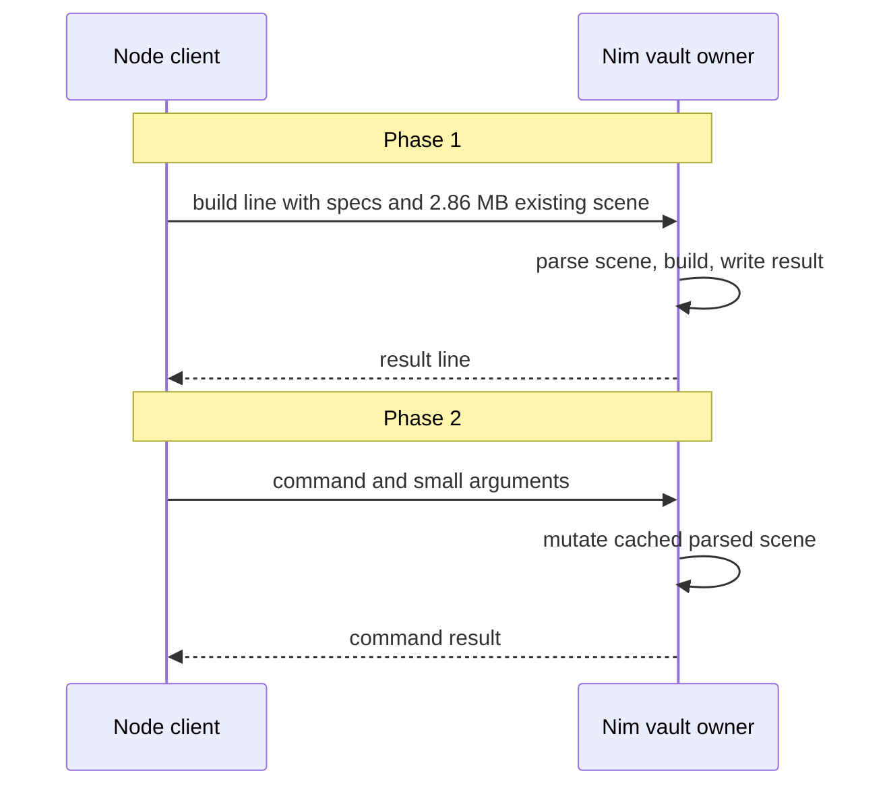
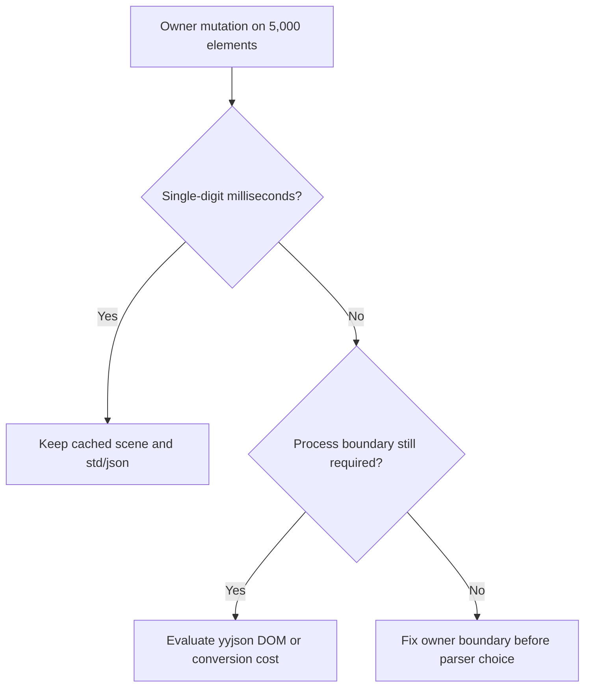

# Transport spike: remove the scene from each mutation

Status: local decision record. Not committed.

Date: 2026-11-24

## Decision

The runtime boundary cost is the 2.86 MB scene transfer, not Nim arithmetic. Do not micro-optimize the core further before removing that transfer.

Phase 2 makes Nim the vault owner. The owner keeps the parsed scene in memory and receives only commands and their arguments. It returns only results. This makes the core-only number the real mutation number instead of one part of a repeated parse and write cycle.

Keep `std/json` in phase 1. Keep `yyjson` as the fallback if a process boundary must remain.

## Measured baseline

Measurements used Nim 2.2.14 with `-d:release --opt:speed` on an Apple M2. The request held 5,000 existing elements and 100 arrow specs. Its serialized size was 2.86 MB.

| Measurement | Time |
|---|---:|
| Core build after fixes, `--bench`, request parsed once | 4.85 ms |
| `std/json` parse | 42.8 ms |
| Node `JSON.stringify` | 2.6 ms |
| Nim parse, build, and write | 59.8 ms |
| Node parse of the response | 0.16 ms |
| Full warm round trip with `std/json` | 62.6 ms |
| `yyjson` parse, before conversion to `JsonNode` | 3.73 ms |
| `yyjson` write | 2.08 ms |
| Text workload, 100 labels, before the by-value lookup fix | 150 ms |
| Text workload, 100 labels, after the fix | 3.0 ms |
| Large-scene build before the indexed ordered store | 472 ms |
| Large-scene build after the indexed ordered store | 4.85 ms |

The warm round trip matches its parts within rounding. Node spends 2.76 ms on serialization and response parsing. Nim spends 59.8 ms on the request parse, build, and response write. The request parse alone costs 42.8 ms, more than eight times the 4.85 ms core build.

`yyjson` parses this request 11 times faster than `std/json`. That measurement stops before any conversion into the core's `JsonNode` tree. Its 2.08 ms write result also excludes conversion in the other direction.

## What the core fixes proved

The text fix removed a copied `FontTable` from the per-glyph path. `METRICS[family]` returned an object containing a `Table` by value. Reading through `addr METRICS[family]` removed the deep copy. The 100-label workload fell from 150 ms to 3.0 ms.

The large-scene fix replaced a sequence scan on every association insert. `AssociationStore` now keeps an ordered `seq` for output and a `Table[string, int]` for string-key lookup and update. The same workload fell from 472 ms to 4.85 ms.

Both were root-cause fixes. Neither changed the fact that every phase 1 request still carries and parses the full scene. More arithmetic tuning would work on the smaller number.

## Phase 2 boundary



The owner must preserve the existing storage rules. Every mutation still snapshots first, checks the revision, writes atomically, and returns the new revision. Those file operations remain real work. The 4.85 ms core number does not include them.

Measure the owner boundary separately from core work and persistence. A single-digit result must cover the same 5,000 element scene and 100 arrow mutation through the owner interface, not only a call to `buildElements` with an already parsed request.

## `yyjson` fallback

Do not adopt `yyjson` in phase 1. The current core accepts and returns `JsonNode` throughout. Using the yyjson DOM as the core value type would touch every module and change ownership rules. Converting between the yyjson DOM and `JsonNode` adds a second tree and gives back part of the parse win.



If the phase 2 cache and owner do not reach single-digit milliseconds on the 5,000 element scene, revisit `yyjson` before discarding the approach. First separate boundary, conversion, core, and persistence time. Choose the yyjson DOM only if the conversion layer would consume the measured gain.

## Reproduction

Run the core-only measurement from the repository root:

```sh
npm run build:core
./nim/bin/sketchdex-core --bench request.json 100 --metrics server/font-metrics.json
```

The benchmark parses the request once, performs one warmup, then times repeated builds. Use `npm run bench:core` for the full JavaScript and persistent Nim comparison. Keep the request size, element count, arrow count, compiler flags, and machine fixed when comparing phases.
